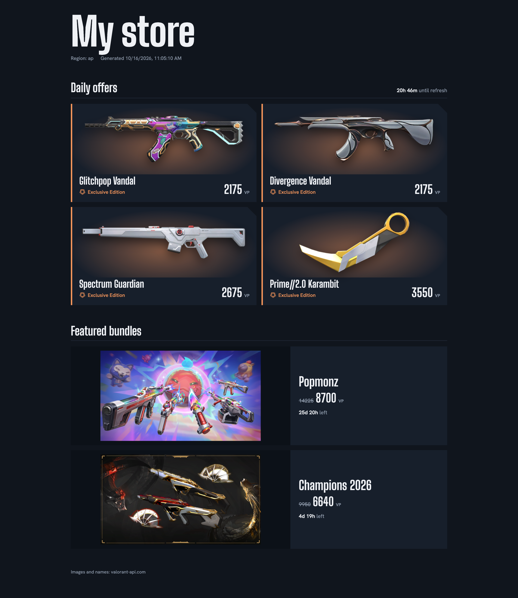

<p align="right"><a href="README.md">English</a> | 中文</p>

<h1 align="center">Valorant Skin Glance</h1>

<p align="center">
  
  
  
</p>

<p align="center">
  <a href="https://nodejs.org/"></a>
  <a href="https://developer.mozilla.org/docs/Web/JavaScript"></a>
  <a href="https://developer.mozilla.org/docs/Web/HTML"></a>
  <a href="https://developer.mozilla.org/docs/Web/CSS"></a>
</p>

一个轻量、零依赖的 Node.js 脚本，用来查看你当前的 VALORANT 商店——每日皮肤、捆绑包和夜市。结果可以直接显示在终端里，也可以生成一个本地 HTML 页面，带有皮肤图片、稀有度颜色和实时倒计时。

> **说明：** 本工具完全在你自己的电脑上运行——不涉及后端、登录表单或数据库。它依赖 Riot 的非官方接口，这些接口随时可能变化。使用前请先阅读[免责声明](#免责声明)。

---

## 目录

- [目录](#目录)
- [致谢](#致谢)
- [截图](#截图)
- [免责声明](#免责声明)
- [为什么这种方式能降低风险](#为什么这种方式能降低风险)
- [环境要求](#环境要求)
- [快速开始](#快速开始)
  - [1. 获取你的 `ssid`](#1-获取你的-ssid)
  - [2. 添加到 `.env`](#2-添加到-env)
- [命令](#命令)
- [保持会话有效](#保持会话有效)
- [问题排查](#问题排查)
- [工作原理](#工作原理)
  - [1. 使用 `ssid` cookie 登录](#1-使用-ssid-cookie-登录)
  - [2. 获取商店接口所需的信息](#2-获取商店接口所需的信息)
  - [3. 请求商店](#3-请求商店)
  - [4. 把 UUID 转成可读内容](#4-把-uuid-转成可读内容)
  - [5. 输出](#5-输出)
  - [为什么要设置 TLS？](#为什么要设置-tls)
  - [局限性](#局限性)

---

## 致谢

本工具受以下项目启发：

- [giorgi-o/skinpeek](https://github.com/giorgi-o/skinpeek)
- [krizad/valorant-store-bot](https://github.com/krizad/valorant-store-bot)

---

## 截图

<p align="center">
  
</p>

`--html` 生成的页面会列出每日商店、捆绑包，以及夜市（开放期间）。

---

## 免责声明

本项目依赖 **非官方、未公开文档的 Riot 接口**，并使用你账号的 `ssid` 会话 cookie 进行认证。使用前请先阅读：

- **这些接口是非官方的，随时可能变化。** Riot 并不公开或支持这些接口。如果 Riot 更新了认证流程、商店接口或反机器人保护，本工具可能会失效，直到有人更新它。
- 本项目**与 Riot Games 没有任何关联，也未获得其认可**。VALORANT 和 Riot Games 是 Riot Games, Inc. 的商标。
- 使用这些接口**违反 Riot 的开发者政策**。请**仅用于你自己的账号**，风险自负。
- 你的 `ssid` 等同于一个已登录的会话。**不要分享它，不要贴到 issue 里，也不要提交到 git。**
- 皮肤名称和图片来自社区接口 [valorant-api.com](https://valorant-api.com)。

---

## 为什么这种方式能降低风险

很多第三方 VALORANT 商店工具会要求你输入 Riot 的用户名和密码，或者把它们收集到服务器上。本工具在设计上就避开了这一点：

- **从不需要用户名或密码。** 脚本不会询问它们，也没有登录表单。它看不到你的密码，因此也没有密码可以泄露、记录或存储。
- **凭证来自 Riot 官方网站。** 你提供的唯一机密是 `ssid` 会话 cookie，它是你自己在 Riot 官网（`auth.riotgames.com`）登录后得到的。你的密码和任何二次验证码只会发给 Riot。
- **不会上传到任何数据库或服务器。** 没有后端。脚本在你的电脑上运行，把 `ssid` 保存在本地的 `.env` 文件里（权限 `600`）。它只会发送给 `auth.riotgames.com`，也就是你的浏览器本来就会发送的那个主机。
- **网络目的地很少。** 只有 Riot 自己的主机（认证、权益、区服查询和你所在区服的商店服务器），以及用来获取名称和图片的 [valorant-api.com](https://valorant-api.com)。不会向 valorant-api.com 发送任何凭证。生成的 HTML 页面还会在你的浏览器里从 Google Fonts 加载字体，从 valorant-api.com 的 CDN 加载图片。
- **容易审计。** 整个工具只有一个零依赖的文件 `valorant-shop.mjs`，没有 `node_modules`，也就没有第三方代码有机会读取你的 cookie。

与要密码的工具相比，这样做能降低风险，但并不能完全消除风险。`ssid` 仍然是一个已登录的会话：任何拿到它的人，在它失效之前都可以冒充你。请保管好 `.env`，不要提交到 git（把 `.env` 和 `valorant-shop.html` 加进 `.gitignore`）；如果它泄露了，请到 Riot 账号设置里退出所有设备。

---

## 环境要求

- Node.js 18 或更高版本
- 一个已经在浏览器里登录的 Riot 账号（只需要复制一次 `ssid` cookie）

不需要 `npm install`。

---

## 快速开始

### 1. 获取你的 `ssid`

1. 在浏览器里打开 <https://auth.riotgames.com> 并登录，勾选 **保持登录**。
2. 打开开发者工具（F12）→ **Application** → **Cookies** → `https://auth.riotgames.com`。
3. 复制 `ssid` cookie 的**值**。

提示：建议用无痕窗口完成这一步，之后不要再继续使用那个浏览器会话。Riot 每次重新认证都会轮换 cookie，所以如果那个会话还在浏览器里继续运行，可能会让你交给脚本的那份失效。

### 2. 添加到 `.env`

```bash
cp .env.example .env
```

然后把值粘贴到 `.env` 里：

```
SSID=eyJ...
```

你也可以粘贴整段 cookie 字符串（例如 `ssid=...; clid=...`）。

---

## 命令

在项目文件夹里打开终端，根据需求运行对应的命令。

```bash
node valorant-shop.mjs                  # 在终端里打印你的商店
node valorant-shop.mjs --html           # （推荐）生成 valorant-shop.html 并在浏览器里打开
node valorant-shop.mjs --html --no-open # 只生成 HTML 文件，不打开
node valorant-shop.mjs --json           # 输出原始的商店 JSON
node valorant-shop.mjs --lang zh-CN     # 皮肤名称和页面文字的语言（默认 en-US）
node valorant-shop.mjs --browser        # 排查问题用：使用浏览器 User-Agent 和 Node 默认的 TLS 设置
node valorant-shop.mjs --verbose        # 打印每一次 HTTP 请求
node valorant-shop.mjs --help           # 显示用法
```

环境变量 `SSID` 的优先级高于 `.env`：

```bash
SSID="eyJ..." node valorant-shop.mjs
```

---

## 保持会话有效

Riot 每次认证都会签发一个新的 `ssid`。当值来自 `.env` 时，脚本会把新的 cookie 写回 `.env`（文件权限 `600`），所以经常运行它就能让会话持续下去。如果你是通过环境变量传入 `SSID`，则不会写回任何内容。

会话在不使用的情况下能保持多久由 Riot 决定，官方没有公开说明。建议每隔几天运行一次，并且不要同时运行两个实例，否则它们会互相覆盖对方的 cookie。

---

## 问题排查

| 提示信息 | 可以尝试 |
|----------|----------|
| `Missing SSID` | 用 `.env.example` 创建 `.env` 并填写 `SSID`，或者设置环境变量 `SSID` |
| `Cookie is invalid or expired`（被重定向到 `/login`） | 在无痕窗口里重新登录，复制新的 `ssid`，并立刻运行脚本。不要再使用那个浏览器会话 |
| 换了新 cookie 仍然失败 | 确认复制了完整的 `ssid` 值，最后再试一下 `--browser`（浏览器 User-Agent 和默认 TLS 设置） |
| `returned 403` / Cloudflare | 机房 IP 和 VPN 常常被拦截，请换成家用网络再试 |
| 某个请求突然返回 4xx/5xx 或数据异常 | Riot 可能改了非官方接口，请看看本工具是否有新版本 |
| 其他情况 | 加上 `--verbose` 运行，看看是哪个请求失败 |

错误输出里只包含 cookie 的**名称和长度**，不会包含它们的值，所以向别人求助时可以放心贴出来。

---

## 工作原理

VALORANT 游戏客户端通过 HTTP 接口和 Riot 的服务器通信，商店只是其中一次调用。本脚本发出的请求和客户端是一样的，只不过用的是你已经在浏览器里登录的会话，而不是用户名和密码。

```
.env (ssid) ──► auth.riotgames.com ──► access token + ID token
                                          │
                  ┌───────────────────────┼───────────────────────┐
                  ▼                       ▼                       ▼
         entitlements token         PUUID (from JWT)      region / shard lookup
                  └───────────────────────┼───────────────────────┘
                                          ▼
                     pd.{shard}.a.pvp.net  storefront  ──► raw offer UUIDs
                                          │
                     valorant-api.com  ───┘  UUIDs ──► names, images, rarity
                                          ▼
                              terminal output  /  valorant-shop.html
```

### 1. 使用 `ssid` cookie 登录

当你在浏览器里登录 Riot 后，`auth.riotgames.com` 会设置一个长期有效的会话 cookie，名叫 `ssid`。脚本带着这个 cookie 向 OAuth 的 `authorize` 接口发请求，使用的 client ID 和 VALORANT 官网相同（`play-valorant-web-prod`）。如果会话仍然有效，Riot 会返回一次重定向，URL 的 fragment 里带有 **access token** 和 **ID token**。脚本直接从 `Location` 头里读取它们，不会真的跟随重定向。如果会话已失效，Riot 会重定向到登录页，脚本会把这种情况报告为 cookie 已过期。

同一个响应还会轮换 cookie。脚本会合并新的 `Set-Cookie` 值，并且如果 `ssid` 来自 `.env`，就把它们写回去，这样下次运行就会从最新的值开始。

### 2. 获取商店接口所需的信息

商店接口还需要几样东西，它们都由 access token 得到：

- **Entitlements token** – 用 access token 作为 bearer token，向 `entitlements.auth.riotgames.com` 请求。它证明你的账号拥有哪些内容。
- **PUUID** – 你的玩家 ID。它就是 access token（一个 JWT）里的 `sub` 字段，所以不需要额外请求。
- **区服和 shard** – `riot-geo.pas.si.riotgames.com` 会返回你账号所在的区服（例如 `na`、`eu`、`ap`、`kr`），它决定了服务器主机名 `pd.{shard}.a.pvp.net`。LATAM 和 BR 使用 `na` shard。
- **客户端版本** – 商店接口要求带上当前的 VALORANT 客户端版本号。它从 valorant-api.com 读取，因此不用写死也能保持最新。

### 3. 请求商店

脚本向 `POST https://pd.{shard}.a.pvp.net/store/v3/storefront/{puuid}` 发送请求，带上 access token、entitlements token、客户端版本和一个平台头。响应中包含：

- 每日商店（`SkinsPanelLayout`）以及距离轮换的剩余秒数，
- 捆绑包（`FeaturedBundle`），
- 夜市（`BonusStore`），开放期间才会有。

其中所有内容都只是裸 UUID，例如皮肤等级 ID；价格则以货币 ID 作为键（VP 的 ID 是 `85ad13f7-3d1b-5128-9eb2-7cd8ee0b5741`）。

### 4. 把 UUID 转成可读内容

由社区维护的 [valorant-api.com](https://valorant-api.com) 可以把 UUID 对应成显示名称、图片和稀有度等级。脚本每次运行会下载一次皮肤表和稀有度表，再逐个查询每件商品。稀有度决定了 HTML 页面上的强调色。名称会根据 `--lang` 本地化。

### 5. 输出

终端模式下，结果以纯文本形式打印。使用 `--html` 时，脚本会在脚本旁边生成一个独立的页面（`valorant-shop.html`），并用系统默认的程序打开。页面上的倒计时是在浏览器里根据绝对结束时间计算的，所以页面打开期间会一直跳动。想看最新的商店，请重新运行脚本。

### 为什么要设置 TLS？

Riot 的认证接口位于 Cloudflare 之后，如果请求的 TLS 指纹和真实的游戏客户端差别太大，可能会被拒绝。因此脚本会按与客户端相同的顺序请求相同的加密套件和签名算法，并发送客户端的 User-Agent。`--browser` 参数会把认证请求改成浏览器的 User-Agent 和 Node 默认的 TLS 设置，作为备用方案。

### 局限性

- 以上所有内容都依赖 Riot 的非官方接口，Riot 一改就可能失效。
- 脚本不处理二次验证提示，也不支持用户名和密码登录；它只会复用浏览器里已有的会话。
- 只显示每日商店、捆绑包和夜市。
